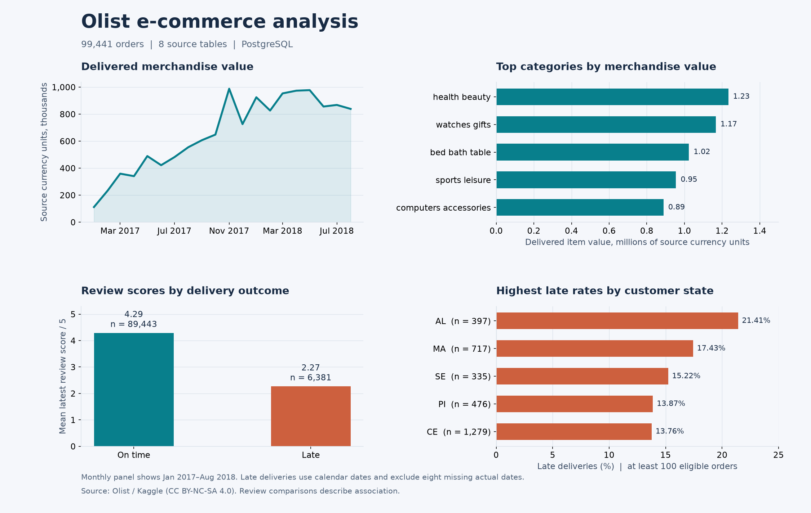
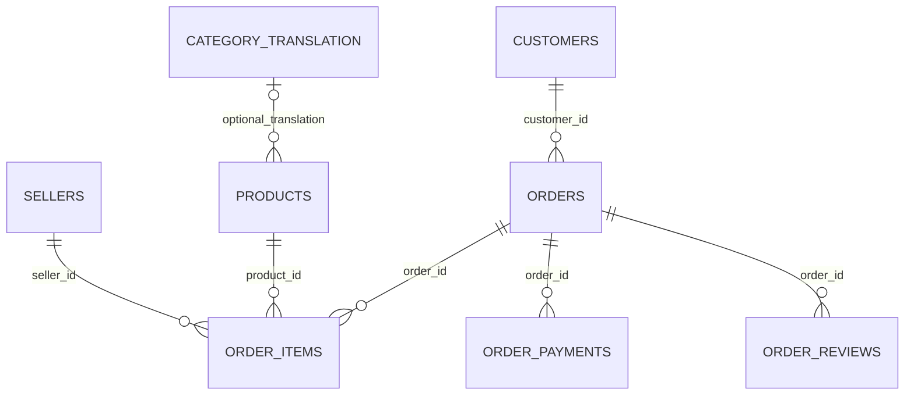

# Olist E-Commerce SQL Analysis

**Sales mix, delivery reliability, customer purchasing and review scores across 99,441 orders.**

A PostgreSQL portfolio project using Olist's anonymised Brazilian e-commerce dataset. Eight related source tables support 15 business analyses, reusable order-level views, data-quality checks, and a reproducible report.



## Business questions

Where does delivered merchandise value come from? Which locations have less reliable delivery? How do review scores differ for late orders? How often do customers return during the observed period?

The project combines customer, order, item, payment, review, product, seller and category-translation data. It demonstrates relational modelling, joins, CTEs, conditional aggregation, window functions, ranking, percentiles, cohort analysis and reconciliation.

## Selected findings

| Measure | Result |
| --- | ---: |
| Orders / distinct customer identifiers | 99,441 / 96,096 |
| Orders marked delivered | 96,478 |
| Delivered merchandise value | 13,221,498.11 |
| Mean merchandise value per delivered order | 137.04 |
| Eligible delivered orders with usable delivery dates | 96,470 |
| Orders arriving after the estimated calendar day | 6,534 (6.77%) |
| Mean latest review score, on time / late | 4.29 / 2.27 |
| Customers with multiple delivered orders in the sample | 2,801 (3.00% of delivered-order customers) |

São Paulo contributes **38.33%** of delivered merchandise value. Among states with at least 100 eligible orders, Alagoas has the highest late-delivery rate at **21.41%**, across 397 orders. These descriptive findings identify areas for further investigation. They do not measure the effect of an operational change.

**Metric scope:** delivered merchandise value sums item prices for orders marked delivered. Freight and recorded payments are separate measures. Monetary values retain the source currency units because the CSVs do not label a currency. Cost, refunds and accounting net revenue are unavailable.

Read the [findings and interpretation](docs/findings.md), [complete results](results/analysis.md), and [metric definitions](docs/methodology.md).

## Reproduce the project

### 1. Prepare the data

Download the ZIP from the [official Olist Kaggle dataset](https://www.kaggle.com/datasets/olistbr/brazilian-ecommerce), extract it, and run this command from the repository root using Python 3.10 or later:

```sh
python3 scripts/prepare_data.py /path/to/extracted/olist/folder
```

The script checks all eight required CSV headers and copies the files unchanged into `data/raw/`. It records row counts, sizes and SHA-256 fingerprints in `data/manifest.json`. The large geolocation file is outside this project's scope because customer and seller state are already supplied. Raw CSVs remain local and are excluded from Git.

### 2. Load PostgreSQL

**Docker option** requires Docker Desktop with Compose running:

```sh
cp .env.example .env
```

Edit `.env` to choose a local password, then run:

```sh
docker compose up -d --wait
docker compose exec -T db psql -X -U analyst -d olist_analytics -f sql/run.sql
docker compose exec -T db psql -X -v ON_ERROR_STOP=1 -U analyst -d olist_analytics -f sql/03_analysis.sql
```

The container listens on `localhost:5434`. Connect pgAdmin using database `olist_analytics`, username `analyst`, and the password from `.env`. Set `POSTGRES_PORT` in `.env` if that port is occupied. `docker compose down` stops the container while preserving its named database volume.

**Existing PostgreSQL option** uses PostgreSQL 16 or later and `psql`:

```sh
createdb -h localhost -U postgres olist_analytics
psql -X -h localhost -U postgres -d olist_analytics -f sql/run.sql
psql -X -h localhost -U postgres -d olist_analytics -v ON_ERROR_STOP=1 -f sql/03_analysis.sql
```

Adjust the host, user and port for your installation. On a Mac with PostgreSQL installed under `/Library/PostgreSQL/18`, the executables are in `/Library/PostgreSQL/18/bin/` if your terminal cannot find them.

The loader creates an `olist` schema. Each run reloads only the eight project tables in that schema, inside one transaction. Checks raise an exception on failure and `psql` stops, so failed loads roll back. Run the loader from the **repository root** to resolve the CSV paths.

`run.sql` uses psql commands such as `\copy` and `\ir`, so run it through Terminal or the PSQL Tool. After loading, the SELECT statements in `sql/03_analysis.sql` also work in pgAdmin's Query Tool.

### 3. Export and regenerate the report

Using Docker:

```sh
python3 scripts/export_results.py --docker
```

For an existing PostgreSQL server, configure the usual `PGHOST`, `PGPORT`, `PGUSER` and `PGDATABASE` connection settings, then run:

```sh
python3 scripts/export_results.py
```

To regenerate the report chart and formatted result tables:

```sh
python3 -m venv .venv
source .venv/bin/activate
python -m pip install -r requirements.txt
python scripts/build_report.py
```

The exporter runs each SQL question and creates `results/analysis.json`, including source and query fingerprints. The report builder reads those results to create `docs/findings.md`, `results/analysis.md` and `assets/analysis-overview.png`.

## Analytical design

An order can have several items, payment records and reviews. Joining these raw tables together would multiply rows. The analysis first sums items and payments by order and selects one latest review per order, then joins those results to `orders` and `customers`. Reconciliation checks verify the original monetary totals survive the joins.

Important source decisions:

- `customer_id` links an order to its customer record. `customer_unique_id` identifies repeat customers across orders.
- `(order_id, order_item_id)` and `(order_id, payment_sequential)` identify item and payment rows.
- Review IDs repeat across orders. All 99,224 source review records are preserved with a composite `(review_id, order_id)` key. Order-level review metrics use the latest response, with deterministic tie-breaking.
- Eight delivered orders have missing actual delivery dates. Late rates use only orders with both actual and estimated dates.
- Lateness compares **calendar days**. A delivery later in the day of its estimated date is classified as on time.
- Missing product categories remain visible as `unknown`. Portuguese labels are retained when an English translation is unavailable.
- Monthly reporting includes a continuous calendar. Cohort results omit future periods and flag the latest observed activity month.

See the [data dictionary and methodology](docs/methodology.md) for grains, denominators, missing values, observation windows and limitations.

## Database relationships



The translation relationship is optional and intentionally has no foreign-key constraint because the source contains two untranslated categories.

## SQL analysis map

| Query | Business question | Main techniques |
| --- | --- | --- |
| Q01 | Scale, merchandise value and delivery coverage | Conditional aggregates, `NULLIF` |
| Q02 | Order-status mix | Aggregates, window total |
| Q03 | Monthly performance and growth | Calendar, CTEs, `LAG` |
| Q04 | State contribution and delivery reliability | Joins, distinct customers, weighted rates |
| Q05 | Category contribution | Item grain, translation fallback |
| Q06 | Late rates and delivery-time distribution | `HAVING`, median and 90th percentile |
| Q07 | Delivery outcome and review scores | Latest-record selection, coverage denominators |
| Q08 | Payment-method mix | Split-payment records, value shares |
| Q09 | Observed repeat purchasing | Customer identity, conditional groups |
| Q10 | Monthly customer cohorts | First purchase, period spine, conditional aggregation |
| Q11 | Seller concentration | `ROW_NUMBER`, cumulative window sum |
| Q12 | Freight relative to item value | Ratio of totals, minimum sample size |
| Q13 | Leading categories within each state | `DENSE_RANK`, partitions |
| Q14 | Payment/item reconciliation | Order-level comparisons, missing coverage |
| Q15 | Recency and frequency groups | Fixed reference date, `CASE` |

All statements are in [sql/03_analysis.sql](sql/03_analysis.sql).

## Validation

The full eight-file dataset was imported and reloaded successfully using **native PostgreSQL 18.6**. All 15 business queries, data-quality diagnostics, source-count controls and monetary reconciliations passed. Their results also matched an independent execution in PGlite's embedded PostgreSQL 17.5 engine.

The [GitHub Actions workflow](.github/workflows/postgres-checks.yml) runs on PostgreSQL 16 using a small **synthetic fixture**. It checks multi-item/multi-payment/multi-review joins, latest-review selection, calendar-day lateness, missing dates, empty calendar months, customer identity, cohort periods, repeatable setup, and every analysis query. This CI fixture does not load the full Kaggle dataset.

## Repository guide

- `sql/` contains schema, imports, reusable views, 15 questions, and quality diagnostics.
- `tests/` contains full-dataset controls and synthetic regression checks.
- `scripts/` prepares source files, exports SQL results, and generates the report.
- `data/` records attribution and the source-file manifest.
- `results/` contains the complete SQL snapshot and readable tables.
- `assets/` contains the report chart.
- `docs/` contains methodology, findings, a learning walkthrough, and a CV entry.

Start with the [walkthrough](docs/walkthrough.md) to reproduce and explain the project. The [CV entry](docs/cv_entry.md) describes implemented work without claiming measured business impact.

## Source and licensing

Dataset provided by **Olist and collaborators**, published as **Brazilian E-Commerce Public Dataset by Olist** on Kaggle under [CC BY-NC-SA 4.0](https://creativecommons.org/licenses/by-nc-sa/4.0/). The imported source bytes are unchanged. Views, aggregate outputs, findings and charts are project-created transformations and are shared under the same license. See [data/README.md](data/README.md).

Original project SQL, Python, synthetic fixtures and documentation are available under the [MIT license](LICENSE). Dataset-derived results, charts and findings follow the separate data license stated above.

Data modelling, metric choices, implementation, validation and interpretation are documented for review and further study.
