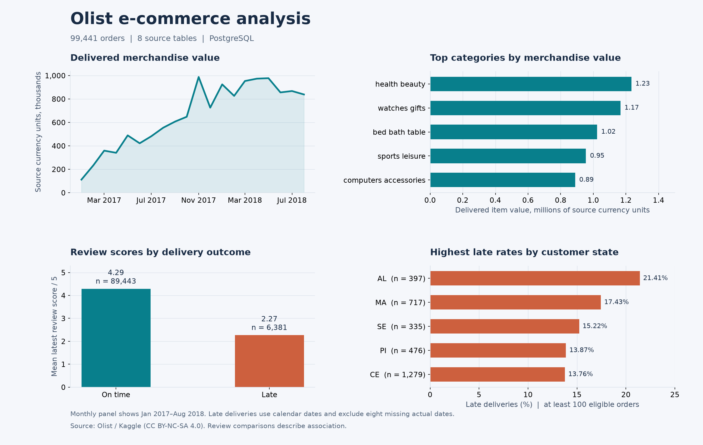

# Findings and business interpretation

This report is generated from [15 PostgreSQL analyses](../sql/03_analysis.sql). The [complete result tables](../results/analysis.md) and [machine-readable snapshot](../results/analysis.json) make each finding traceable. Olist supplied the anonymised commercial dataset through Kaggle. Monetary values retain the source currency units.

## Scope and definitions

The dataset includes **99,441 orders**, **96,096 unique customer identifiers**, and 112,650 item records. Of these orders, **96,478** have status `delivered` (Q01–Q02).

Delivered merchandise value is **13,221,498.11**, with mean merchandise value of **137.04** per delivered order (Q01). This metric sums item prices for delivered orders. Freight is tracked separately. The CSVs do not provide a cost or refund ledger, so the project does not calculate profit or accounting net revenue.

## Delivery reliability and review scores — Q06–Q07

Of **96,470** delivered orders with actual and estimated delivery dates, **6,534** arrived after the estimated calendar day. The late-delivery rate is **6.77%**. Eight orders marked delivered have no actual delivery timestamp and are excluded from this denominator.

The average latest review score is **4.29/5 for on-time orders** and **2.27/5 for late orders**. Low scores of 1–2 stars account for **9.27%** and **62.42%** of reviewed orders in those groups, respectively. Review coverage is 99.45% for on-time orders and 97.66% for late orders.

This is an association in observed orders. Product mix, sellers, geography, and other factors may also affect review scores. It does not estimate the causal effect of delivery delays.

Alagoas (`AL`) has the highest late rate among states with at least 100 eligible deliveries, at **21.41% across 397 orders**. Maranhão (`MA`) follows at **17.43% across 717 orders**. The 100-order threshold is an analyst-defined screen. It does not establish statistical significance.

**Suggested follow-up:** investigate the order-to-carrier and carrier-to-customer intervals in states with high rates, alongside order volumes and seller mix. The sample supports identifying investigation candidates. No operational change or improvement has been measured.

## Geographic contribution — Q04

| Customer state | Delivered orders | Delivered item value | Item-value share | Late-delivery rate |
| --- | ---: | ---: | ---: | ---: |
| SP | 40,501 | 5,067,633.16 | 38.33% | 4.49% |
| RJ | 12,350 | 1,759,651.13 | 13.31% | 12.11% |
| MG | 11,354 | 1,552,481.83 | 11.74% | 4.57% |
| RS | 5,345 | 728,897.47 | 5.51% | 6.08% |
| PR | 4,923 | 666,063.51 | 5.04% | 4.04% |

São Paulo contributes **38.33%** of delivered merchandise value. Rio de Janeiro combines substantial order volume with a **12.11%** late rate. This makes it a candidate for investigating both delay frequency and the number of affected orders. Customer state represents the location attached to each order's customer record.

## Category and freight mix — Q05 and Q12

**health_beauty** is the largest category by delivered merchandise value, at **1,233,131.72** or **9.33%** of the total. Watches/gifts and bed/bath/table follow. Category order counts can overlap because one order can include items from several categories.

Christmas supplies has recorded freight equal to **36.52%** of merchandise value across 150 delivered items. This ratio describes charged freight relative to item prices. It is not a measure of shipping cost or profitability.

## Repeat purchasing and cohorts — Q09–Q10

Among customers with at least one delivered order, **2,801 customers (3.00%)** placed two or more delivered orders during the observed period. Customer identity uses `customer_unique_id`, because `customer_id` identifies an order-linked customer record.

The cohort table groups customers by the month of their first delivered-order purchase and measures distinct customers active in later calendar months. Future months are left unavailable. Very small early cohorts can show extreme percentages, and the latest observed activity month can be partial. These figures describe observed repeat purchasing within Olist's sample rather than a complete customer lifetime.

## Payments and reconciliation — Q08 and Q14

**credit_card** accounts for **78.34%** of all recorded payment value. This query includes all order statuses. Split-payment orders can contribute to more than one payment method.

Across orders with both item and payment records, 303 orders have a difference greater than one cent between recorded payment value and item value plus freight. The net recorded difference is 2,870.39. These differences require source interpretation. They do not establish refunds, financial losses, or fraud.

## Data quality and analytical limits

- The imported tables retain the original source records. All row counts and source totals reconcile.
- The 99,224 review rows contain 98,410 distinct review IDs across 98,673 orders. `(review_id, order_id)` is unique. A deterministic latest-response rule selects one review per order for order-level metrics.
- Payments, items and reviews are aggregated or selected to one row per order before joining. This prevents monetary totals from multiplying across one-to-many relationships.
- The file has 775 orders without item records, one without a payment record, and 768 without a review. The order-level view retains these orders and their missing values.
- There are 610 products with no category and 13 products in two categories without English translations. The category query retains Portuguese labels when translation is unavailable.
- The overall purchase range includes sparse early activity and a sparse tail in September–October 2018. The monthly chart focuses on January 2017–August 2018. The SQL exports retain the full calendar, including zero-order months.
- No time-zone offset is supplied in the timestamps. They are stored as `timestamp without time zone`.

## Reproduce the report

After preparing the source files and loading PostgreSQL, run the export and report commands in the README. The JSON snapshot records each query's SHA-256 hash and the source-file manifest so stale results can be identified.
